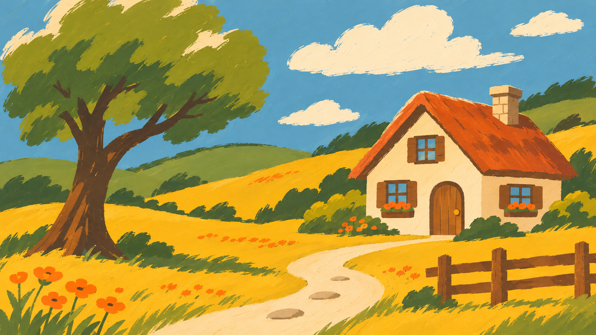

# Edge-Aware Pixel Art Converter

A Python image-processing project that converts images, animated GIFs, and videos into pixel art using block median filtering, dark-pixel averaging, and Canny edge detection. The goal is to simplify fine details while retaining prominent dark outlines.

Use the **Google Colab notebook** (`pixel_art.ipynb`) or run the **standalone Python script** (`pixel_art.py`) from your computer. Both use the same core algorithm.

## Example Results

| Original image | Processed image |
| -------------- | --------------- |
|  |  |

## How It Works

The algorithm divides an image into non-overlapping square blocks. Each block receives one representative color:

1. **General regions:** The median color reduces fine texture and produces cleaner color regions.
2. **Dark outlines:** Blocks containing enough dark pixels and detected edges use the average color of their dark pixels instead.

A 3 × 3 Gaussian blur is applied before Canny edge detection.

### Default Parameters

| Parameter | Default | Description |
| --------- | ------- | ----------- |
| `BLOCK_SIZE` | 10 | Width and height of each square block |
| `DARK_THRESHOLD` | 60 | Pixels with lower average intensity count as dark |
| `MIN_DARK_FRACTION` | 0.30 | Minimum proportion of dark pixels in a block |
| `MIN_EDGE_FRACTION` | 0.05 | Minimum proportion of detected edge pixels |
| Canny thresholds | 50, 150 | Low and high edge detection thresholds |

## Option 1: Run in Google Colab

1. Open [Google Colab](https://colab.research.google.com/).
2. Select **File → Upload notebook** and choose [`pixel_art.ipynb`](pixel_art.ipynb).
3. Run the notebook's code cell and upload your image, GIF, or video when prompted.
4. The processed file downloads automatically. Static images may also display in the notebook.

Change the parameters at the beginning of the code cell to adjust the pixelation effect.

## Option 2: Run Locally with Python

Install Python 3 and the dependencies:

```sh
pip install -r requirements.txt
```

Or install them directly:

```sh
pip install opencv-python numpy Pillow
```

Run the script from a terminal:

```sh
python pixel_art.py photo.png
```

It saves `photo_pixelated.png` in the same folder. **No preview window opens.** You can use the same command with GIF or video files:

```sh
python pixel_art.py animation.gif
python pixel_art.py video.mp4
```

To change the block size or output filename:

```sh
python pixel_art.py photo.png --block-size 10
python pixel_art.py photo.png --output result.png
```

Other available options are `--dark-threshold`, `--min-dark-fraction`, and `--min-edge-fraction`. Use `python pixel_art.py --help` to see them.

For video processing, **FFmpeg with the `libx264` encoder must be installed** and accessible from your terminal. Video outputs are encoded as MP4 (H.264). The current implementation does not retain audio.

**Supported input formats:** PNG, JPG/JPEG, BMP, WEBP, GIF, MP4, AVI, MOV, MKV, and WEBM. Animated GIF outputs may lose transparency because frames are converted to RGB before processing.

## Project Files

- [`pixel_art.ipynb`](pixel_art.ipynb) — Google Colab notebook with upload/download controls.
- [`pixel_art.py`](pixel_art.py) — standalone Python script for local use, with no preview.
- [`requirements.txt`](requirements.txt) — Python dependencies for the standalone script.
- `examples/` — original and processed example images (`7.png` and `7r.png`).

## Results and Limitations

The algorithm usually preserves larger shapes and strong dark outlines while reducing fine textures. Small details can disappear depending on the block size. Fixed thresholds may need adjustment for images with different brightness or contrast.

An experimental all-edge variant produced a stronger pixel-art appearance but more visual noise. Future work may include resolution-based block-size selection and adaptive thresholds.

Video frames are processed independently, which may cause flicker, and the current implementation does not retain audio.
